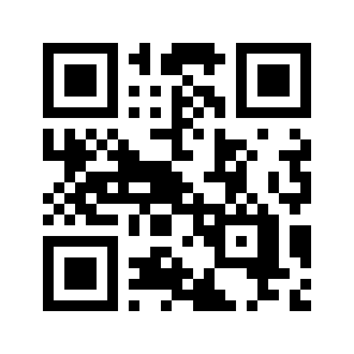
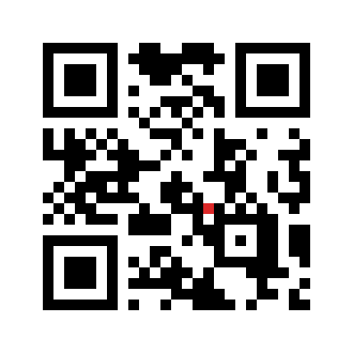

<div align="center">

# QR-Inking

**A printed QR code that scans as one host and sits one square of ink away from another.**

[](LICENSE)
[](paper/qr-inking.pdf)
[](https://qr-inking.whisper.security)

Kaveh Ranjbar, Whisper Security

</div>

---

A QR code that a normal generator prints for a URL is not one dot away from a different host. Two same-length URLs are Reed-Solomon codewords, and they sit at least `d_min = n_ec + 1` symbols apart. A single module cannot cross that gap. If you flip one square on a clean code, the decoder corrects it and you still land on the host you started with.

QR-Inking is the symbol that does cross it. It is printed, not generated clean. It already carries `t = floor(n_ec / 2)` symbol errors aimed at one chosen neighbour, and it still decodes as the real host, so every scanner and every person sees the right name. One more flip, a single square of ink added or removed, lands the decoder on the neighbour instead.

This is a coding-theory result with a printing method attached. We are publishing it, together with the detection, because the defence is cheap and the construction is already in the literature.

## Contents

- [The claim, stated carefully](#the-claim-stated-carefully)
- [See it](#see-it)
- [Two worked examples](#two-worked-examples)
- [How it works](#how-it-works)
- [Reproduce](#reproduce)
- [What the harness checks](#what-the-harness-checks)
- [Detecting it](#detecting-it)
- [Limits](#limits)
- [Responsible disclosure](#responsible-disclosure)
- [Repository layout](#repository-layout)
- [The paper](#the-paper)
- [Citation](#citation)
- [License](#license)
- [Prior work](#prior-work)

## The claim, stated carefully

The precise version matters here, because the loose version ("a QR is one dot from a fake") is false and we do not want anyone repeating it.

- **A clean QR code is safe.** Flip any single module on a code that came out of a normal generator and it still decodes to the original URL. The error correction absorbs it.
- **The attack is a printed symbol, not a generated one.** It starts life already sitting on the decoding radius: it holds `t = floor(n_ec / 2)` preloaded symbol errors that all point at one neighbour `B`, and it decodes as the real host `A` anyway.
- **One flip finishes it.** From that boundary symbol, the user set is `|D| - 2t` of the lightest allowed symbols. On a minimum-weight pair with even `n_ec` that is one symbol, and when its popcount is one, that is a single module. Add ink or remove ink, and the decoder returns `B`.
- **Polarity is a choice.** The flip can be darken (add ink, `0 -> 1`), lighten (remove ink, `1 -> 0`), or either, and the tool ranks conflicts under whichever you pick.
- **It is not a homograph and not a TLD swap.** The two hosts are the same byte length. Changing the length of the name, swapping the TLD, or inserting a dot is a different and larger distance, and it is not this attack.

## See it

- **Live explorer:** [qr-inking.whisper.security](https://qr-inking.whisper.security). Paint a boundary symbol, watch the decode flip in the browser, and generate a safer QR for your own link.
- **The paper:** [`paper/qr-inking.pdf`](paper/qr-inking.pdf). The construction, the validation, and the limits in full.

## Two worked examples

Both are measured, not asserted. The numbers come straight out of `qr_domain_flip.py --check`, which decodes four symbols for every claim: the clean code, the printed boundary, the boundary after the one flip, and a stock code with that same module flipped (the negative control, which must stay on the real host).

### google.com, remove ink

`https://google.com` is 18 bytes. A default generator emits version 2, level M. Its same-length neighbour `googlg.com` is 17 symbols and 54 modules away on a clean code. The boundary symbol closes all but one of those.

| | value |
|---|---|
| From, to | `https://google.com` -> `https://googlg.com` |
| Version, level, mask | 2-M, mask 0, 1 block |
| Symbol distance, radius | 17 symbols, radius 8 |
| User module | `(15, 15)`, host character 13 |
| Preloaded symbols | 8 |
| Flip | remove ink (lighten) |

<div align="center">

| Clean code | Printed boundary | After one flip |
|:---:|:---:|:---:|
| scans `google.com` | scans `google.com` | scans `googlg.com` |
|  |  |  |

</div>

### kaveh.org, a different TLD

`https://kaveh.org` is 17 bytes, version 2, level M. The cheap neighbour here is not a misspelling of the name. It is a different, real top-level domain. `kaveh.org` and `kaveh.ong` (`.ong` is the registry for non-profits) are two squares of ink apart.

| | value |
|---|---|
| From, to | `https://kaveh.org` -> `https://kaveh.ong` |
| Version, level, mask | 2-M, mask 0, 1 block |
| Symbol distance, radius | 18 symbols, radius 8 |
| User modules | 2, at `(8, 16)` and `(13, 2)` |
| Preloaded symbols | 8 |

The decode check: the clean code and the printed boundary both read `kaveh.org`, flipping those two modules reads `kaveh.ong`, and the same two modules on a stock code stay on `kaveh.org`. Both ends are delegated TLDs, so the morph lands on a name an attacker can register.

`googlg.com` is a coding witness, not a claim that the string is registered or confusable. `kaveh.ong` is different: it is a real TLD. That is the sharper result below.

### Morphing between TLDs

The same construction morphs same-length top-level domains into each other, with both ends real TLDs in the IANA root. A code for a host under one TLD becomes a host under another by adding or removing a few modules: `.ai` to `.am`, `.live` to `.life`, `.net` to `.new`, `.com` to `.cam`, each a small ink edit onto a registrable TLD. It reaches restricted namespaces too: `.net` to `.int`, or `.com` to `.gov`, real TLDs an attacker cannot own but can still point a scan at.

The full method and the measurement are in the paper.

### Real-world targets

The cost of a TLD morph depends only on the name length, so every brand of a given length inherits it, and the codes people scan most are printed payment and login codes. Alipay's merchant QR encodes `https://qr.alipay.com/<code>`; a single TLD edit, `com` to `cam`, turns it into `https://qr.alipay.cam/<code>`, decode-verified. The one-edit neighbour is already a registered domain: `alipay.cam` is held through Alibaba Cloud's own registrar (Dominet (HK) Limited). The one-edit neighbours of other payment and login hosts fall into three cases, each real today: open to register (`tenpay.cam` and `qq.cam` are unregistered), defensively held by the brand (`venmo.cam`, through PayPal's brand registrar), or held by a third party (`paypal.cam`). China and Southeast Asia, where printed QR is the default payment rail, are the high-stakes case. The paper has the full table, the registration status, and the damage per case.

## How it works

Full detail is in the paper and in [`docs/measurement-note.md`](docs/measurement-note.md). The short version, for a pair of same-length URLs `A` and `B` at a chosen version, level and mask:

1. Encode both in byte mode and lay out the ISO/IEC 18004 block structure, appending each block's Reed-Solomon parity. Blocks are independent codes with `d_min = n_ec + 1` and `t = floor(n_ec / 2)`.
2. In each block, let `D` be the symbols where the two codewords differ.
3. The user set `U` is the `|D| - 2t` lightest symbols of `D`, ties broken toward a symbol that overlaps the hostname.
4. The preload `P` is any `t` symbols of `D \ U`. Everything else stays equal to `A`.
5. Render `A` (interleave, zigzag placement, mask, format and version bits), then invert the modules of `P`. That printed symbol sits at distance `t` from `A`, so a decoder of radius `t` returns `A`.
6. Invert the modules of `U`. Now the symbol is at distance `t` from `B` and more than `t` from `A`, so the decoder returns `B`.

The reference implementation is `qr_domain_flip.py`. Its renderer is checked module-for-module against [segno](https://github.com/heuer/segno), and its decode claims are checked against a real detector. See below.

## Reproduce

```bash
git clone https://github.com/whisper-sec/whisper-qr-inking
cd whisper-qr-inking
python3 -m venv .venv && source .venv/bin/activate
pip install -r requirements.txt
```

Then:

```bash
# google.com: rank the one-module neighbours, then decode all four symbols
python3 src/qr_domain_flip.py https://google.com --version 2 --level M --top 8
python3 src/qr_domain_flip.py https://google.com --version 2 --level M --check --png-dir qr_demo

# kaveh.org, the remove-ink example
python3 src/qr_domain_flip.py https://kaveh.org --version 2 --level M --check

# pick the polarity, add ink or remove ink
python3 src/qr_domain_flip.py https://google.com --polarity darken --top 8
python3 src/qr_domain_flip.py https://google.com --polarity lighten --top 8

# the ISO detection radius instead of floor(n_ec / 2)
python3 src/qr_domain_flip.py https://google.com --version 2 --level L --iso --check

# the full host-edit measurement sweep behind the paper's tables
python3 src/qr_sweep.py

# the TLD-morphing study across the whole IANA root (the paper's core result)
python3 tld_research.py --tlds data/tlds-alpha-by-domain.txt --out out/tld-research.json
# one TLD morph end to end on the decoder: .net scans, add ink, now it scans .int
python3 src/qr_domain_flip.py https://google.net --to https://google.int --version 2 --level M --check
```

`--check` prints the four decoded strings. `--png-dir` writes the clean code, the boundary symbol with the user module in red, and the symbol after the flip.

## What the harness checks

Every number the paper quotes is regenerated, not transcribed. The checks are:

- **Renderer against segno.** The encoded matrix matches segno module-for-module, with zero difference, across versions 2-L, 2-M, 2-Q, 3-M, 4-M, 5-L and 6-M, on masks other than 0 as well, including multi-block versions where the blocks have unequal data length.
- **Decode, four ways.** For each claimed pair the clean code, the printed boundary and the flipped symbol decode as expected, and the negative control (a stock code with the same module flipped) stays on the real host. Every decode runs on two independent decoders, OpenCV's current Aruco detector (5.0.0 family) and ZXing (zxing-cpp), which agree; the paper's examples were also flipped on a phone camera in the field.
- **The one-module count.** The sweep over every single-character host edit reports how many are one module, how many of those land inside the hostname, and which versions fall back to two (the odd-`n_ec` cases, version 1-L and 3-L).

## Detecting it

The symbol that makes this work is also what gives it away. A clean scan of a QR-Inking symbol is already sitting on the decoding radius, with `t` corrected symbols that all point at one neighbour. Ordinary wear and tear does not do that.

- **Watch the correction trace.** Flag any scan whose corrected-symbol count is `t` or `t - 1`. The format information tells you the level, so you know `t`.
- **Invert and redecode.** Flip each data module in turn and decode again. A stock code stays on its host. A one-module boundary symbol has exactly one module that moves it to a different host.

This is the deterministic end of the fake-QR construction of Takita, Okuma and Morii (CANDAR 2018), and the error-correction-trace detection of Ohigashi, Kawaguchi, Kobayashi et al. (2021) catches it, precisely because a clean scan is already on the radius.

## Limits

- **Odd `n_ec`.** When the error-correction count is odd, `d_min = 2t + 2` and the minimum user edit is two symbols, not one. Version 1-L and version 3-L are the clear cases.
- **Block boundaries.** A character that straddles two blocks contributes a user symbol in each, so that edit is two modules.
- **Length changes.** A TLD swap, an inserted dot, or any edit that changes the byte length is a different distance and is out of scope.
- **ISO radius.** ISO/IEC 18004 holds back two syndromes on some versions, so a strict reading corrects fewer errors than `floor(n_ec / 2)`. The `--iso` flag selects that smaller radius; real detectors we tested do not hold the syndromes back.

## Responsible disclosure

The construction here is a precise, reproducible version of a QR error-correction attack that is already published (see [Prior work](#prior-work)). We are releasing it with the detection in the same repository, because the detection is the point: a scanner or a security team can flag this symbol from the correction trace of a single clean read, before anyone flips anything.

If you find a real deployment of this in the wild, or you build on the detection, we want to hear about it: **security@whisper.security**.

## Repository layout

```
whisper-qr-inking/
  README.md                  this file
  LICENSE                    MIT
  requirements.txt           segno, numpy, pillow, opencv-python, zxing-cpp
  src/
    qr_domain_flip.py        reference implementation and CLI
    qr_sweep.py              the host-edit measurement sweep
  tld_research.py            the IANA-root TLD-morphing study
  tld_morph.py               the TLD morph-cost sweep
  data/
    tlds-alpha-by-domain.txt the IANA root zone TLD list
  paper/
    qr-inking.pdf            the paper
  docs/
    measurement-note.md      the long-form measurement write-up
  figures/                   paper figures
  demo/                      clean, boundary and flipped example codes
```

## The paper

[`paper/qr-inking.pdf`](paper/qr-inking.pdf), *Tattooing the Root Zone*, is the full write-up: the construction, the IANA-root TLD-morphing study, the validation (two decoders and a phone), the detection, and the limits. The paper is licensed CC BY 4.0; the reference code in this repository is MIT.

## Citation

```bibtex
@techreport{ranjbar2026qrinking,
  title       = {Tattooing the Root Zone: QR-Inking and Same-Length TLD Morphing Across the IANA Root},
  author      = {Ranjbar, Kaveh},
  institution = {Whisper Security},
  note        = {Preprint},
  year        = {2026},
  url         = {https://github.com/whisper-sec/whisper-qr-inking}
}
```

## License

The reference code, the harness, and this repository are MIT (see [LICENSE](LICENSE)). The paper, `paper/qr-inking.pdf`, is licensed CC BY 4.0. Copyright (c) 2026 Kaveh Ranjbar, Whisper Security. The knowledge, the code, and the paper are free to use, with attribution.

## Prior work

- M. Takita, H. Okuma, M. Morii. *A Construction of Fake QR Codes Based on Error-Correcting Codes.* CANDAR 2018, pp. 188-193.
- T. Ohigashi, S. Kawaguchi, K. Kobayashi, et al. *Detecting Fake QR Codes Using Information from Error-Correction.* Journal of Information Processing, vol. 29, pp. 548-558, 2021.
- K. Krombholz, P. Fruehwirt, P. Kieseberg, I. Kapsalis, M. Huber, E. Weippl. *QR Code Security: A Survey of Attacks and Challenges for Usable Security.* HAS 2014, LNCS 8533, pp. 79-90.
- A. Dabrowski, K. Krombholz, J. Ullrich, E. Weippl. *QR Inception: Barcode-in-Barcode Attacks.* ACM SPSM 2014.
- ISO/IEC 18004. Block structure, generator and placement, as implemented by segno 1.6.6.
